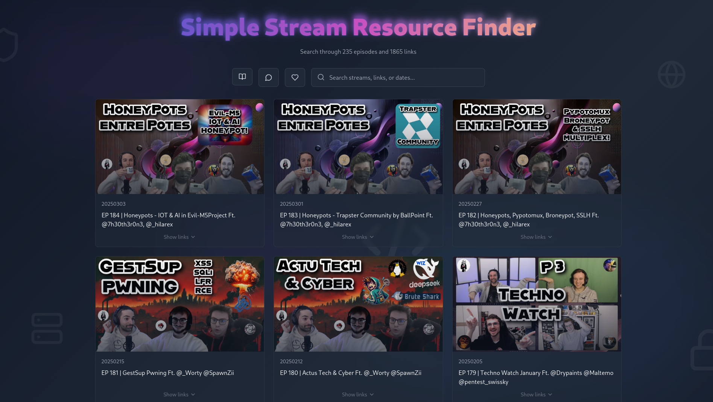

# Simple Stream Resource Finder

A minimalist web application to search and browse through stream resources.

> [https://linktr.ee/TheLaluka](https://linktr.ee/TheLaluka)



## Features

- 🔍 Real-time search through stream content
- 📱 Responsive design for mobile and desktop
- 🎨 Clean, modern UI with dark theme
- 🔗 Quick access to Discord and social links
- 📖 Stream guidelines and best practices

## Tech Stack

- React + TypeScript
- Tailwind CSS
- Lucide Icons
- GitHub Actions for CI/CD

## Development

```bash
# Install Node.js 24 and yt-dlp with mise (or install them yourself)
mise install

# Install locked dependencies
npm ci --include=dev

# Populate the database
npm run populate

# Rebuild from cached metadata without accessing YouTube
npm run populate:offline

# Refresh metadata for every video, including cached descriptions
npm run populate -- --refresh

# Start development server
npm run dev

# Build for production
npm run build

# Lint, typecheck, test the importer, and build
npm run check

# Check dependency advisories
npm audit
```

The importer reads the channel's videos, streams, and Shorts, fetching metadata
only for uncached or undated videos by default. It preserves cached videos that
are no longer listed publicly. New metadata stores only the fields used by this
site; resource links are deduplicated and output ordering is deterministic.
Failed fetches leave the generated database unchanged and exit with an error.
Set `YT_DLP_BIN` to use a specific yt-dlp executable.

`update-content.sh` runs the refresh and checks from the repository directory,
then commits and pushes only metadata and the generated database when they
change. It requires a clean worktree and working Git authentication. The GitHub
Pages workflow validates the committed data and deploys pushes to `main`.

The frontend uses React 19, React Router 7, Vite 8, and Tailwind CSS 4. TypeScript
stays on 6.0 because typescript-eslint currently supports versions below 6.1.
Tailwind 4 requires Safari 16.4+, Chrome 111+, or Firefox 128+; see the
[Tailwind upgrade guide](https://tailwindcss.com/docs/upgrade-guide).

